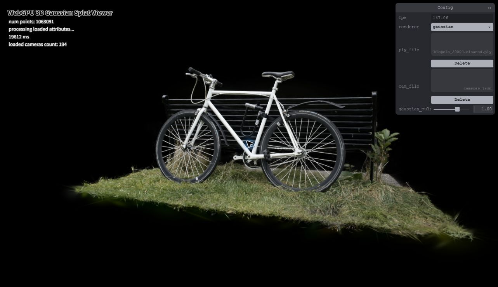
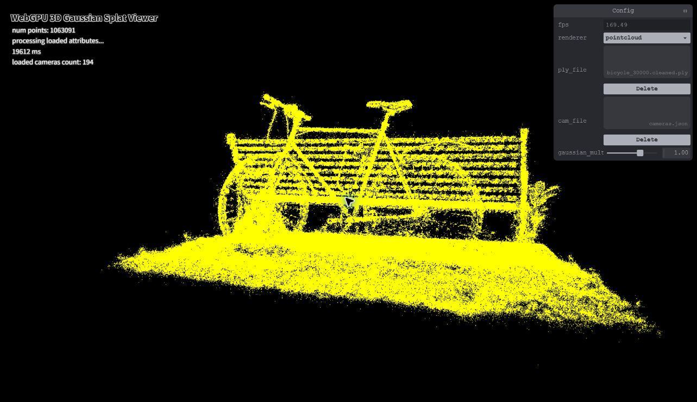
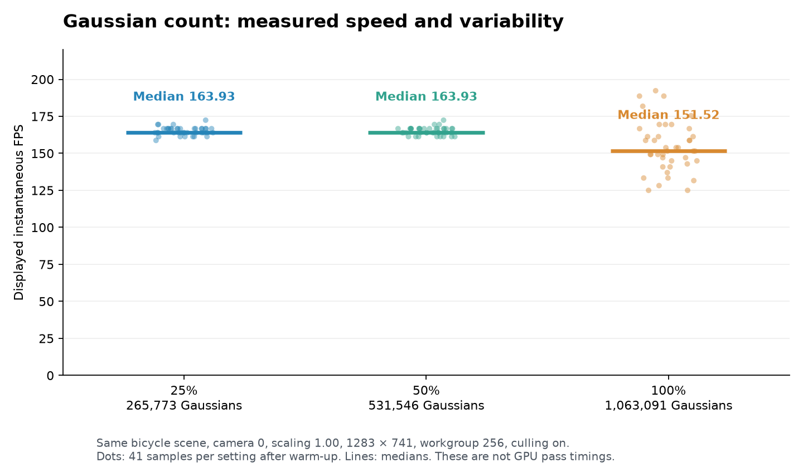

# WebGPU 3D Gaussian Splat Viewer

**University of Pennsylvania · CIS 565 · Project 5**

**Xuan Zhu**

An interactive browser renderer for pretrained 3D Gaussian scenes, implemented
in TypeScript and WGSL. It projects Gaussian distributions to screen-space
ellipses, sorts them by depth on the GPU, and alpha-blends their contributions.



[Live viewer](https://ronan83.github.io/Project5-WebGPU-Gaussian-Splat-Viewer/) ·
[42-second demonstration video](public/demo.mp4)

## Run locally

```sh
npm ci
npm run dev
```

Open the local URL printed by Vite in a WebGPU-capable browser. Download the
[course scene files](https://drive.google.com/drive/folders/1Fz0QhyDU12JTsl2e7umGi5iy_V9drrIW?usp=sharing),
then use the panel to select a Gaussian PLY and its matching cameras.json.
Select **gaussian** to view splats or **pointcloud** for the yellow-dot baseline.
Large scene files are excluded from version control.

### Controls

| Input | Action |
| --- | --- |
| Left drag | Rotate camera |
| Right drag | Pan camera |
| Mouse wheel | Move along viewing direction |
| 0–9 | Select a loaded camera preset |
| Q / E | Roll camera |
| gaussian_multiplier | Adjust Gaussian scale |

## Implemented features

- Point-cloud rendering with view and projection transforms.
- 3D covariance reconstructed from Gaussian rotation and log-scale values.
- Perspective projection to 2D covariance, conic inversion, and three-sigma quad extents.
- Near-camera rejection and padded screen-space culling.
- View-dependent spherical-harmonics color and sigmoid opacity.
- GPU atomic compaction, the supplied GPU radix sorter, and indirect instanced drawing.
- Gaussian opacity falloff and alpha blending.
- Deterministic PLY subset generation for repeatable count experiments.

Each Gaussian frame follows **preprocess → depth sort → indirect quad rendering**.
Packed storage uses f16 values; the projection calculations use f32.

## Measurement setup

Verified locally with Chrome **156.0.8078.48**, Windows 11 Home, and an AMD Ryzen
AI 7 350 machine with NVIDIA GeForce RTX 5070 Laptop GPU and AMD integrated
graphics available. The application requests a high-performance WebGPU adapter;
these measurements do not independently identify the selected adapter.

All recorded comparisons use bicycle camera preset 0, scale 1.00, and a
**1283 × 741** canvas. The PLY filename contains “30000”, but the full file
actually has **1,063,091 Gaussians**. Workgroup size is 256 and culling is enabled
unless a particular experiment changes one of them.

The tables summarize sampled readings from the existing **instantaneous FPS
display**. They are not complete-run average frame rates or GPU pass timings.
Each run includes approximately five seconds of warm-up. Raw readings and
screenshots are linked with each experiment. Short-run variability limits
conclusions about small differences.

## Performance analysis

### 1. Point cloud versus Gaussian rendering

Both modes were measured on the same full scene and camera, with 41 displayed
FPS samples per mode after warm-up.

| Renderer | Median displayed FPS | Observed range |
| --- | ---: | ---: |
| Point cloud | 163.93 | 158.73–172.41 |
| Gaussian | 151.52 | 125.00–192.31 |

Point-cloud mode shows separated yellow samples and gaps. Gaussian rendering
adds colored, overlapping ellipses with soft edges, producing more continuous
surfaces. It also performs covariance projection, evaluates view-dependent
color, sorts depth keys, and blends fragments over the projected quads. The
Gaussian run had a lower sampled median here; overlapping ranges and possible
presentation limits prevent a precise GPU cost ratio from these readings.

| Point cloud | Gaussian splats |
| --- | --- |
|  |  |

[Point-cloud raw readings](analysis/renderers/renderer-pointcloud.json) ·
[Gaussian raw readings](analysis/gaussian-count/count-100.json)

### 2. Preprocessing workgroup size

The original local Viewer was tested with 1,063,091 Gaussians from
`bicycle_30000.cleaned.ply`, camera preset 0, Gaussian scaling 1.00, and a
1283 × 741 canvas. Each configuration was warmed up for approximately five
seconds, followed by 21 samples of the displayed instantaneous FPS.

| Workgroup size | Median displayed FPS | Observed range |
| --- | ---: | ---: |
| 64 | 153.85 | 128.21–185.19 |
| 128 | 149.25 | 128.21–163.93 |
| 256 | 147.06 | 125.00–172.41 |

The 64-thread configuration had a median approximately 4.6% above 256 in this
comparison, but the observed ranges overlap substantially. These short runs
do not establish a reliable winner. Workgroup size can affect scheduling and
resource allocation, while sorting and rasterization also contribute to total
frame time. The measurements are samples of the existing FPS display rather
than isolated GPU preprocessing timings or averages over every rendered frame.

The sorting capacity was held at 3840 keys per dispatch. Frustum culling was
enabled in all three workgroup-size measurements.

See the [full explanation, raw readings, and screenshots](analysis/workgroup-size/README.md).

### 3. View-frustum culling

Using the same bicycle scene, camera preset 0, scaling 1.00, workgroup size
256, and 1283 × 741 canvas, I compared the screen-space culling check with
that check disabled. Near-camera rejection remained enabled in both cases.
After approximately five seconds of warm-up per run, I sampled the existing
instantaneous FPS display 41 times at approximately 0.5-second intervals.

| Screen-space culling | Median displayed FPS | Observed range |
| --- | ---: | ---: |
| Disabled | 149.25 | 126.58–172.41 |
| Enabled | 149.25 | 129.87–172.41 |

This viewpoint showed no clear performance improvement: the sampled medians
were identical and the ranges substantially overlapped. Culling can avoid
downstream preprocessing, sorting, and submitted rendering work for rejected
Gaussians, but its benefit depends on the viewpoint and remaining costs.
Surviving counts and per-pass GPU timings were not measured, so the cause of
this small difference is not established. These short runs do not imply that
culling is ineffective in general. The final code has culling enabled.

See the [full explanation, raw readings, and screenshots](analysis/frustum-culling/README.md).

### 4. Gaussian count

The same scene was sampled by retaining every fourth or second complete PLY
record, preserving all attributes of each retained Gaussian. The renderer and
camera remained unchanged. Each setting has 41 instantaneous FPS readings.

| Input fraction | Gaussian count | Median displayed FPS | Observed range |
| --- | ---: | ---: | ---: |
| ~25% | 265,773 | 163.93 | 158.73–172.41 |
| ~50% | 531,546 | 163.93 | 161.29–172.41 |
| 100% | 1,063,091 | 151.52 | 125.00–192.31 |



The smaller subsets had medians about 8.2% above the full scene in this run,
but reducing the count from half to quarter did not improve the sampled median.
The ranges overlap. A presentation or CPU limit could explain the plateau,
but this experiment did not isolate that cause. More input Gaussians increase
preprocessing work; surviving Gaussians add sorting and quad work. Fragment
cost also depends on projected area and overlap. Lower counts reduce surface
coverage and fine detail, so the speed comparison comes with a quality tradeoff.

See the [sampling method, image comparison, raw data, and reproduction command](analysis/gaussian-count/README.md).

## Live demo and video

The [online Viewer](https://ronan83.github.io/Project5-WebGPU-Gaussian-Splat-Viewer/)
has been deployed through GitHub Actions and verified by loading the full bicycle
PLY and its camera file in Chrome, selecting Gaussian rendering, and checking
the rendered image and browser logs. Scene files are selected locally and are
not included in the hosted bundle.

[Watch the 42-second demonstration](public/demo.mp4), or open the
[hosted MP4](https://ronan83.github.io/Project5-WebGPU-Gaussian-Splat-Viewer/demo.mp4).
It is a silent recording of the original local Viewer at 1280 × 740 and 30 FPS.

| Time | Demonstrated behavior |
| --- | --- |
| 0:00–0:06 | Full-scene Gaussian rendering |
| 0:06–0:12 | Point-cloud baseline |
| 0:12–0:17 | Return to Gaussian rendering |
| 0:17–0:22 | Gaussian scale 0.50 |
| 0:22–0:27 | Gaussian scale 1.50 |
| 0:27–0:32 | Scale 1.00 and camera preset 1 |
| 0:32–0:37 | Camera preset 2 |
| 0:37–0:42 | Return to camera preset 0 |

The FPS monitor in the video is affected by recording overhead and is not used
as performance-analysis data. See [demo and deployment verification](analysis/demo/README.md)
for the capture method and deployment evidence.

### Credits

- [Vite](https://vitejs.dev/)
- [tweakpane](https://tweakpane.github.io/docs//v3/monitor-bindings/)
- [stats.js](https://github.com/mrdoob/stats.js)
- [wgpu-matrix](https://github.com/greggman/wgpu-matrix)
- Special Thanks to: Shrek Shao (Google WebGPU team) & [Differential Guassian Renderer](https://github.com/graphdeco-inria/diff-gaussian-rasterization)

### Presentation references

The [reference review notes](analysis/reference-review.md) identify the PRs and
README sections reviewed for presentation and experimental-design ideas.
The measurements, explanations, sampling utility, and screenshots here were
produced for this repository. No peer renderer implementation was imported.
