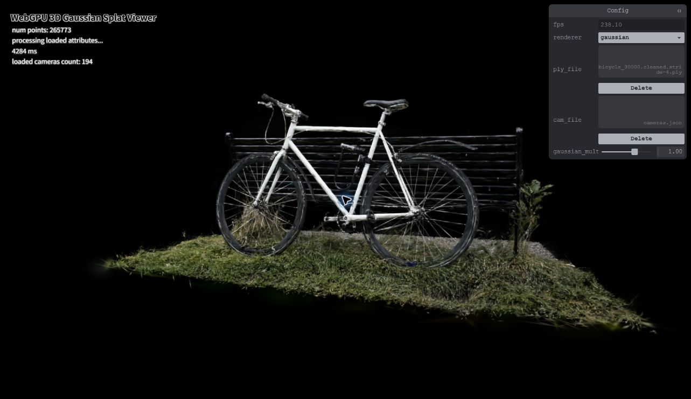
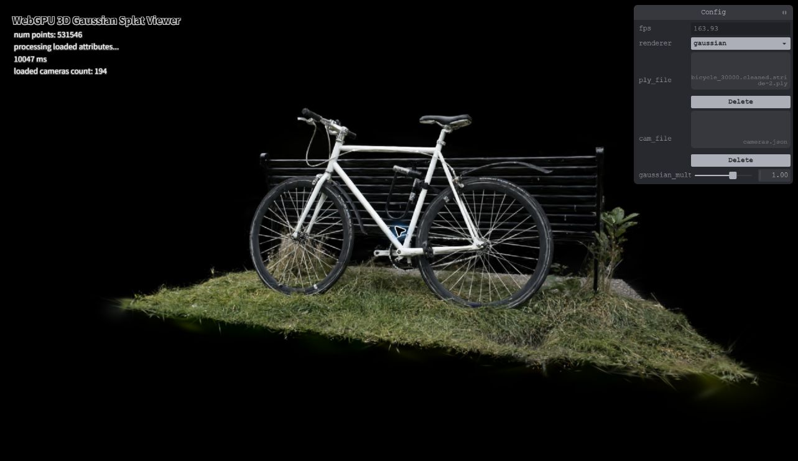

## 4. Effect of Gaussian count on performance

The count experiment uses three versions of the **same bicycle scene**, rather than comparing unrelated scenes. The full file contains 1,063,091 Gaussian records. A small, independently written file-preparation tool keeps every second or fourth complete record to produce approximately 50% and 25% subsets. Each retained record preserves its position, rotation, scale, opacity, and all spherical-harmonics coefficients. This is deterministic sampling across the source ordering, not a prefix of the scene; it is not guaranteed to be an unbiased random sample.

All three files were loaded through the original local Viewer's existing file picker. The renderer was unchanged. Camera preset 0, scale 1.00, workgroup size 256, screen-space culling enabled, and a 1283 × 741 canvas were held fixed. Each file started from a reloaded page. After approximately five seconds of warm-up, 41 readings were taken from the instantaneous FPS display, approximately 0.5 seconds apart.

| Retained records | Gaussian count | Median displayed FPS | Observed displayed FPS range |
| --- | ---: | ---: | ---: |
| ~25% | 265,773 | 163.93 | 158.73–172.41 |
| ~50% | 531,546 | 163.93 | 161.29–172.41 |
| 100% | 1,063,091 | 151.52 | 125.00–192.31 |


The two smaller subsets had medians approximately **8.2% above the full scene** in this run. Halving the count again did not improve the sampled median. The ranges overlap, and these short sequential runs do not establish statistical significance. The plateau near 164 FPS is consistent with a presentation or CPU-side limit, but this experiment did not measure the display cap or GPU stage timings, so it does not identify the limiting component.

Increasing the input count increases preprocessing invocations and storage requirements. More surviving Gaussians can also add sort keys and quad vertices. Fragment work depends on projected area and overlap as well as count, so FPS need not scale linearly with the number of input records. The lower-count images have less accumulated opacity and visible loss of fine structure around the wheels, bench, and ground. Thus, reducing count changes image quality as well as speed.

| ~25% | ~50% | 100% |
| --- | --- | --- |
|  |  |  |

These screenshots are individual moments captured after sampling; their FPS label may differ from the table. The table is derived from the JSON readings, not from screenshot labels. The percentages describe input record counts, not measured post-culling visible counts.

### Reproduce the subsets

From the repository root, with the original scene downloaded:

```sh
node scripts/sample-ply.mjs data/scenes/bicycle/bicycle_30000.cleaned.ply data/scenes/bicycle/count-study 2 4
```

The utility validates a vertex-only binary little-endian PLY, checks its body length, preserves complete records, refuses to overwrite existing output files, and saves counts plus SHA-256 checksums in a manifest. Load the generated files with the original bicycle `cameras.json`. The large scene files remain outside version control.

### Records

- [25% raw samples](count-25.json)
- [50% raw samples](count-50.json)
- [100% raw samples](count-100.json)
- [Sampling manifest](sampling-manifest.json)
